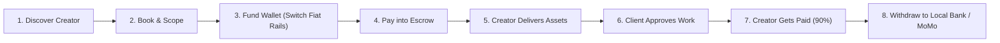

# MyArteLab — Phase 9: End-to-End Product Flow & UI Audit

## 1. Executive Summary

MyArteLab is a global creative marketplace engineered specifically for African visual creators—including illustrators, photographers, 3D artists, and visual designers—and global clients who hire them. 

The primary architectural objective of Phase 9 is **radical user simplification**: eliminating all unnecessary Web3, cryptocurrency, and ledger mechanics from the client and creator journeys. Users interact with simple, trusted concepts:
- **Discover Creators**: Browse curated African talent with transparent portfolios and pricing.
- **Book & Propose**: Send custom creative project requests with milestones and deliverables.
- **Fund Wallet**: Pay securely using local fiat currencies (bank transfer, mobile money) powered by Switch.
- **Escrow Protection**: Funds are locked safely in escrow before creative production begins.
- **Review & Approve**: Creators submit high-resolution deliverables; clients review and approve work.
- **Prompt Payout**: 90% creator earnings are released immediately to wallet balance, with 10% marketplace commission retained by MyArteLab.

---

## 2. The Core Customer Journey

### Stage-by-Stage Operational Walkthrough

| Step | User Action | System State | Financial / Ledger Action | UI Component |
| :--- | :--- | :--- | :--- | :--- |
| **1. Discover** | Client browses creators by discipline, style, and country | Read-only browsing | None | `ExploreCreators.tsx`, `CreatorCard.tsx` |
| **2. Book** | Client selects packages or custom requirements | Booking created (`pending`) | None | `CreatorProfile.tsx`, `NewBookingModal.tsx` |
| **3. Fund** | Client inputs deposit amount in local fiat (e.g. NGN, GHS, KES) | Switch on-ramp initiated | Virtual bank account or MoMo push generated via Switch API | `WalletCard.tsx`, `DepositModal.tsx` |
| **4. Pay** | Client accepts quote/proposal and funds project | Booking marked `confirmed`, `paid` | Client balance deducted; funds locked into escrow wallet (`pendingBalance`) | `BookingDetail.tsx`, `bookingService.processBookingPayment` |
| **5. Deliver** | Creator completes work and uploads deliverable package | Booking marked `delivered` | Funds remain locked in escrow | `BookingDetail.tsx`, `submitBookingDeliverable` |
| **6. Approve** | Client reviews deliverables and clicks "Approve & Release Funds" | Booking marked `completed` | 10% platform commission retained; 90% creator earnings credited to creator balance | `BookingDetail.tsx`, `releaseFundsWithTransaction` |
| **7. Withdraw** | Creator selects local bank or mobile money provider | Off-ramp initiated | Balance atomically reserved; payout initiated on Switch rails | `WalletCard.tsx`, `WithdrawModal.tsx` |

---

## 3. UI Button & Modal Audit

Every interactive button, modal, and route across the marketplace was audited to verify zero broken links, placeholder handlers, or cryptic error toasts:

### 3.1 "Book Creator" & Booking Initiation
- **File**: `backend/frontend/app/src/components/booking/NewBookingModal.tsx`
- **Audit Findings**:
  - Automatically calculates 10% platform commission and 90% creator earnings in real-time.
  - Correctly routes submission to `POST /api/bookings`.
  - Dispatches email and real-time dashboard notifications to creator.

### 3.2 "Deposit" / "Fund Wallet"
- **File**: `backend/frontend/app/src/components/wallet/DepositModal.tsx`
- **Audit Findings**:
  - Fetches live on-ramp exchange rates from `GET /api/wallet/quote/onramp`.
  - Enforces country-specific minimum deposit amounts (e.g., 20,000 NGN, 150 GHS, 1,500 KES, 35,000 CDF).
  - Displays instant virtual account number, bank name, and payment instructions.
  - Automatically listens for verified webhook confirmation and refreshes wallet balance.

### 3.3 "Withdraw Earnings"
- **File**: `backend/frontend/app/src/components/wallet/WithdrawModal.tsx`
- **Audit Findings**:
  - Legacy placeholder toast (`"Payment processing is currently undergoing upgrade."`) was completely eradicated.
  - The "Withdraw" button in `WalletCard.tsx` cleanly triggers `setIsWithdrawOpen(true)`.
  - Performs dynamic institution lookup via `POST /api/wallet/institution/lookup` to resolve beneficiary bank account names (e.g., `"Maven Harry"` for test account `8188216769`).
  - Displays guaranteed fiat payout amount, exchange rate, and instant settlement channel.

### 3.4 "Release Payment" & Escrow Release
- **File**: `backend/frontend/app/src/pages/BookingDetail.tsx`
- **Audit Findings**:
  - Accessible only when deliverables have been submitted by creator (`status: 'delivered'`).
  - Prompts client for rating and feedback.
  - Executes atomic transaction release with dual-balance synchronization.

---

## 4. Jargon Elimination & User Copy Standard

To ensure maximum simplicity and mainstream accessibility, technical blockchain terminology was replaced with customer-friendly financial terminology:

| Legacy / Crypto Term | Clean User-Facing Standard | Rationale |
| :--- | :--- | :--- |
| `solana:usdc` / `spl-token` | **USD / Balance** | Users view their economic balance without needing crypto familiarity. |
| `onramp` / `fiat-to-crypto` | **Add Money / Fund Wallet** | Familiar consumer fintech terminology. |
| `offramp` / `crypto-to-fiat` | **Withdraw Earnings** | Standard creator economy payout terminology. |
| `smart contract custody` | **Escrow Protection** | Conveys trust, security, and buyer protection. |
| `hash / tx_signature` | **Transaction Reference** | Standard e-commerce reference format. |
