# MyArteLab — Phase 9: Master Test Suite Architecture & QA Guide

## 1. Overview & Test Architecture

The Phase 9 Master Test Suite (`backend/scripts/test-phase9-master-suite.js`) is the authoritative end-to-end verification script for the MyArteLab × Switch integration.

It consolidates all previous regression suites into a single deterministic execution covering **15 critical functional categories** and **59 discrete assertions**.

```mermaid
flowchart TD
    Run["npm test<br>(node scripts/test-phase9-master-suite.js)"]
    Run --> Cat1["1. Auth & Onboarding"]
    Run --> Cat2["2. Wallet Provisioning"]
    Run --> Cat3["3. 20-Currency Corridor Scope"]
    Run --> Cat4["4. Institution Lookup & Quotes"]
    Run --> Cat5["5. Virtual Deposit Generation"]
    Run --> Cat6["6. Sandbox Settlement Confirm"]
    Run --> Cat7["7. Off-Ramp Balance Reservation"]
    Run --> Cat8["8. Booking & Counter-Proposals"]
    Run --> Cat9["9. Escrow Payment"]
    Run --> Cat10["10. Deliverable Submission"]
    Run --> Cat11["11. 10% Commission Release"]
    Run --> Cat12["12. Concurrency Defense"]
    Run --> Cat13["13. Webhook HMAC & Replay Window"]
    Run --> Cat14["14. Reversal Recovery"]
    Run --> Cat15["15. Zero Key Leakage"]
```



---

## 2. Test Execution Commands

From the backend directory:

```bash
cd backend
npm test
```

Or invoke directly with Node:

```bash
cd backend
node scripts/test-phase9-master-suite.js
```

> [!NOTE]
> Outbound network access to `https://api.onswitch.xyz` is required to execute real quote generation, account name resolution, and deposit initiation against Switch Sandbox.

---

## 3. The 15 Test Categories & Verified Checks (59/59)

### Category 1: Authentication & New-User Onboarding (4 Checks)
- `1.1`: Client wallet currency is strictly `USDC`.
- `1.2`: Creator wallet currency is strictly `USDC`.
- `1.3`: Client balance and `wallet.balance` initialize in lockstep.
- `1.4`: Creator balance and `wallet.balance` initialize in lockstep.

### Category 2: Non-Custodial Wallet Provisioning & Idempotency (4 Checks)
- `2.1`: Genuine Solana wallet address provisioned on Switch.
- `2.2`: Private key is never returned in public wallet responses.
- `2.3`: Repeated wallet requests return identical internal IDs.
- `2.4`: Repeated wallet requests return identical Solana addresses.

### Category 3: 20-Currency Corridor Audit & Direction Testing (4 Checks)
- `3.1`: Exactly 20 dashboard currencies tested.
- `3.2`: At least 14 active on-ramp corridors quoting live (15/20 verified).
- `3.3`: Nigeria (NGN) off-ramp active and operational.
- `3.4`: Provider-blocked remittance key restrictions documented across corridors (16/16 verified).

### Category 4: Quote & Beneficiary Account Resolution (3 Checks)
- `4.1`: Institution lookup resolves account holder name (`Maven Harry`).
- `4.2`: Off-ramp quote returns guaranteed exchange rate.
- `4.3`: Destination fiat amount calculated accurately.

### Category 5: Deposit Initiation & Virtual Account Generation (2 Checks)
- `5.1`: On-ramp deposit initiated with genuine Switch reference.
- `5.2`: Live virtual deposit bank account generated for customer payment.

### Category 6: Sandbox Deposit Confirmation & Status Tracking (2 Checks)
- `6.1`: `POST /payment/confirm` advances deposit status in sandbox.
- `6.2`: Live status check reflects settlement progression.

### Category 7: Withdrawal Initiation & Atomic Balance Reservation (5 Checks)
- `7.1`: Available balance starts at 100.00 USDC.
- `7.2`: Pending withdrawal locked at 20.00 USDC.
- `7.3`: Available balance reduced to 80.00 USDC during in-flight offramp.
- `7.4`: Total economic balance remains 100.00 USDC until bank delivery.
- `7.5`: Real off-ramp initiated on Switch rails with reference.

### Category 8: Booking Creation & Counter-Proposal Flow (6 Checks)
- `8.1`: Booking `platformCommission` defaults strictly to 10%.
- `8.2`: 50 USDC booking yields 5.00 USDC platform fee.
- `8.3`: 50 USDC booking yields 45.00 USDC creator payout.
- `8.4`: Counter-proposal calculates 10% platform fee (6.00 USDC).
- `8.5`: Counter-proposal calculates 90% creator earnings (54.00 USDC).
- `8.6`: Accepted counter-proposal updates booking amount to 60.00 USDC.

### Category 9: Booking Payment & Escrow Funding (5 Checks)
- `9.1`: Client available balance atomically reduced to 50.00 USDC.
- `9.2`: Client `wallet.balance` matches root balance (50.00 USDC).
- `9.3`: Client pending balance locked in escrow (50.00 USDC).
- `9.4`: Escrow wallet funded with exactly 50.00 USDC.
- `9.5`: Booking `paymentStatus` marked `paid`.

### Category 10: Deliverable Submission & Client Review (2 Checks)
- `10.1`: Deliverable successfully attached to booking.
- `10.2`: Booking status transitions to `delivered`.

### Category 11: Release Funds (10% Commission / 90% Creator Payout) (6 Checks)
- `11.1`: Creator receives exactly 45.00 USDC (90%).
- `11.2`: Creator `wallet.balance` matches root balance.
- `11.3`: Creator `totalEarnings` recorded at 45.00 USDC.
- `11.4`: Client `pendingBalance` fully cleared to 0.00.
- `11.5`: Escrow wallet balance emptied to 0.00.
- `11.6`: Booking marked `completed`.

### Category 12: Concurrency & Overspending Defense (3 Checks)
- `12.1`: Only one 40 USDC reservation succeeds out of two concurrent attempts.
- `12.2`: Overspending reservation correctly rejected due to insufficient funds.
- `12.3`: Available balance strictly defended at 10.00 USDC (cannot go negative).

### Category 13: Webhook HMAC Signature, Replay Defense & Idempotency (5 Checks)
- `13.1`: Valid HMAC-SHA256 signature and fresh timestamp accepted.
- `13.2`: Forged HMAC-SHA256 signature rejected.
- `13.3`: Expired timestamp (>300s) rejected (replay defense).
- `13.4`: First webhook delivery processed.
- `13.5`: Duplicate webhook delivery safely ignored (idempotency).

### Category 14: Failed Provider Responses & Reversal Recovery (2 Checks)
- `14.1`: Failed withdrawal clears pending reservation.
- `14.2`: Reserved funds safely restored to available balance.

### Category 15: Sensitive Key Leakage Defense (4 Checks)
- `15.1`: Serialized wallet object does not contain `private_key`.
- `15.2`: Serialized wallet object does not contain `secret_key`.
- `15.3`: Serialized wallet object does not contain `WALLET_ENCRYPTION_KEY`.
- `15.4`: Serialized wallet object does not contain `SWITCH_SERVICE_KEY`.
