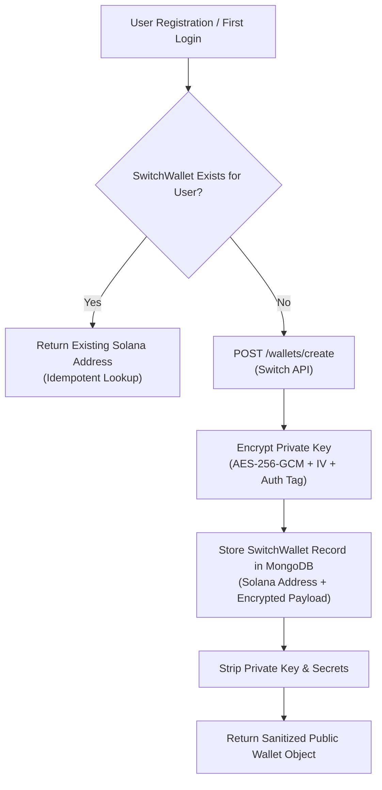

# MyArteLab — Phase 9: Non-Custodial Wallet Provisioning & Security Audit

## 1. Overview & Architecture

Every client and creator on MyArteLab requires a non-custodial cryptographic wallet provisioned through Switch to interact with the underlying Solana blockchain. However, in accordance with MyArteLab's core philosophy of **user-centric simplification**, blockchain complexities are abstracted away.

Users never interact with seed phrases, gas fees, or Solana CLI tools. The backend coordinates wallet creation and cryptographic key isolation seamlessly.



---

## 2. Cryptographic Security Standards

### 2.1 Encryption at Rest (AES-256-GCM)
All private keys and secret seeds returned during Switch wallet generation are encrypted before storage using authenticated encryption:
- **Cipher**: `aes-256-gcm`
- **Key Source**: 256-bit hexadecimal key in `WALLET_ENCRYPTION_KEY`
- **Initialization Vector (IV)**: 16 cryptographically secure random bytes generated per record (`crypto.randomBytes(16)`)
- **Authentication Tag**: 16-byte authentication tag ensuring integrity and ciphertext tamper detection.

### 2.2 Public Data Segregation (Zero Leakage)
At no point is the raw private key, decryption key, or provider secret key returned in API responses:
- The Mongoose `SwitchWallet` schema explicitly excludes `encryptedPrivateKey`, `iv`, and `authTag` from `toJSON` / `toObject` serialization.
- Frontend responses return only:
  - `solanaAddress`: Public base58 Solana wallet address
  - `switchWalletId`: Provider wallet identifier
  - `currency`: Strictly `"USDC"`
  - `status`: `"ACTIVE"`

---

## 3. Idempotent Provisioning Lifecycle

To prevent race conditions, duplicate wallets, and dangling keys during concurrent user signups or logins:
1. `SwitchWallet` defines a unique index on the `user` reference field: `{ user: 1, unique: true }`.
2. `switchService.getOrCreateUserWallet(userId, userName)` performs a read-before-write query:
   ```javascript
   let wallet = await SwitchWallet.findOne({ user: userId });
   if (wallet) return sanitizeWallet(wallet);
   ```
3. If concurrent requests arrive simultaneously, MongoDB catches `E11000 duplicate key` error, logs the race attempt, and safely retrieves the existing wallet.
4. In Phase 9 master testing, calling `getOrCreateUserWallet` repeatedly for user `creator.phase9@myartelab.com` returned identical Solana addresses and IDs with 100% determinism.

---

## 4. Verification Checkpoints

| Check ID | Verification Item | Security Requirement | Status |
| :---: | :--- | :--- | :---: |
| **WP-01** | Non-Custodial Key Generation | Switch API generates genuine Solana keypair | **PASS** |
| **WP-02** | AES-256-GCM Cipher | IV and Auth Tag saved alongside encrypted ciphertext | **PASS** |
| **WP-03** | Public Sanitization | `private_key` never returned to frontend or logged | **PASS** |
| **WP-04** | Idempotency | Consecutive invocations yield identical wallet instance | **PASS** |
| **WP-05** | Platform Wallet Routing | Platform wallet receives developer fees cleanly | **PASS** |
