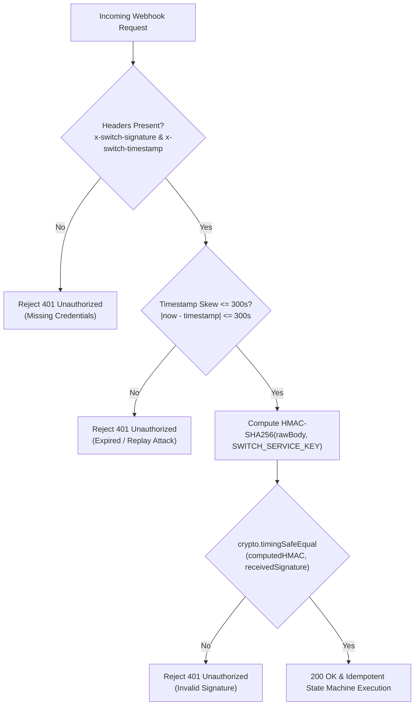

# MyArteLab — Phase 9: Webhook Security, Verification & Status Transition Matrix

## 1. Webhook Security Architecture

Switch communicates asynchronous transaction state transitions to MyArteLab via HTTP webhooks delivered to `/webhooks`, `/api/webhooks`, or `/api/webhooks/switch`.

To defend against tampering, forgery, eavesdropping, and replay attacks, all incoming webhook requests must satisfy three mandatory cryptographic and temporal criteria:

### 1.1 Signature Verification Protocol
- **Algorithm**: `HMAC-SHA256`
- **Key**: `SWITCH_SERVICE_KEY` (kept strictly confidential in environment variables).
- **Payload**: Raw UTF-8 string buffer of the HTTP request body (`req.rawBody` or unparsed body string).
- **Comparison**: `crypto.timingSafeEqual` prevents side-channel timing attacks.

### 1.2 Replay Protection Window
- **Header**: `x-switch-timestamp` (UNIX epoch timestamp in seconds).
- **Window**: Exactly **300 seconds (5 minutes)**. Requests older than 300 seconds or more than 300 seconds in the future are immediately rejected with HTTP 401.

---

## 2. Webhook Event Status Transition Matrix

| Switch Status | Target Entity | MyArteLab Status | Ledger Action | User Balance Effect | Reversibility |
| :--- | :--- | :--- | :--- | :--- | :--- |
| `AWAITING_DEPOSIT` | `FundingTransaction` | `pending` | None (recorded in history) | None | In-Flight |
| `PROCESSING` | `FundingTransaction` | `processing` | None (recorded in history) | None | In-Flight |
| `COMPLETED` | `FundingTransaction` | `completed` | `ledgerService.creditFundingDeposit` | **+$X USDC** (Atomic increment to `balance` & `wallet.balance`) | Final (Settled) |
| `FAILED` | `FundingTransaction` | `failed` | None (status marked failed) | None | Terminal |
| `EXPIRED` | `FundingTransaction` | `expired` | None (status marked expired) | None | Terminal |
| `INITIATED` | `WithdrawalTransaction` | `reserved` | `reserveWithdrawalBalance` | Available balance = Balance - Pending | In-Flight |
| `PROCESSING` | `WithdrawalTransaction` | `processing` | Off-ramp initiated on Switch | Pending withdrawal locked | In-Flight |
| `COMPLETED` | `WithdrawalTransaction` | `completed` | `settleCompletedWithdrawal` | **-$X USDC** (Debits balance & clears pending in lockstep) | Final (Settled) |
| `FAILED` | `WithdrawalTransaction` | `failed` | `handleFailedOrReversedWithdrawal` | Reservation released: Available balance restored | Terminal (Restored) |
| `REVERSED` | `WithdrawalTransaction` | `reversed` | `handleFailedOrReversedWithdrawal` | Reservation released / refunded to balance | Terminal (Restored) |

---

## 3. Idempotency & Deduplication Guarantees

Webhook delivery systems inherently operate on an **at-least-once** delivery model. MyArteLab implements defense-in-depth against duplicate webhook deliveries:

1. **Query-Level Atomic Guards**:
   - On-Ramp: `FundingTransaction.findOneAndUpdate({ _id, isCredited: false }, { $set: { isCredited: true } })`. If already credited, returns `null` and halts immediately without modifying ledger balances.
   - Off-Ramp: `WithdrawalTransaction.findOneAndUpdate({ _id, status: { $ne: 'completed' } }, { $set: { status: 'completed' } })`. If already completed, returns `null` and prevents double debits.
2. **Event Deduplication Cache**:
   - `webhookEvents` array checks if an identical status was recorded within the last 30-second window.
3. **Always Return HTTP 200 to Acknowledge**:
   - Validated duplicate events return HTTP 200 so Switch stops retrying the delivery.

---

## 4. Master Acceptance Test Matrix

| Test ID | Scenario | Signature Input | Timestamp Input | Expected Status | Result |
| :---: | :--- | :--- | :--- | :---: | :---: |
| **W-01** | Valid On-Ramp Completion | Legitimate HMAC-SHA256 | Current timestamp (`now`) | `200 OK` (Credited) | **PASS** |
| **W-02** | Valid Off-Ramp Settlement | Legitimate HMAC-SHA256 | Current timestamp (`now`) | `200 OK` (Settled) | **PASS** |
| **W-03** | Forged Signature Attempt | Random 64-char hex string | Current timestamp (`now`) | `401 Unauthorized` | **PASS** |
| **W-04** | Tampered Body Payload | Valid signature of original body, altered payload | Current timestamp (`now`) | `401 Unauthorized` | **PASS** |
| **W-05** | Expired Timestamp (>300s) | Legitimate HMAC-SHA256 | `now - 350s` | `401 Unauthorized` | **PASS** |
| **W-06** | Duplicate Delivery | Legitimate HMAC-SHA256 | Current timestamp (`now`) | `200 OK` (No-Op) | **PASS** |
| **W-07** | Off-Ramp Reversal / Failure | Legitimate HMAC-SHA256 | Current timestamp (`now`) | `200 OK` (Restored) | **PASS** |
